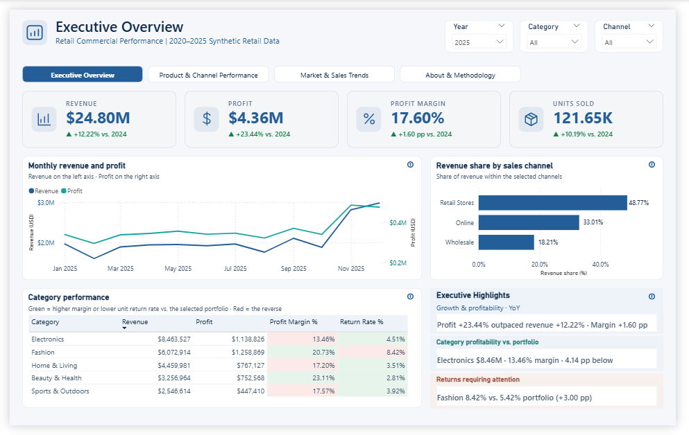
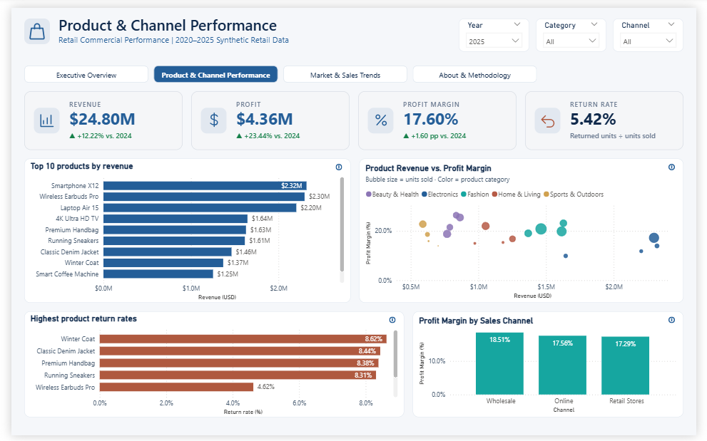
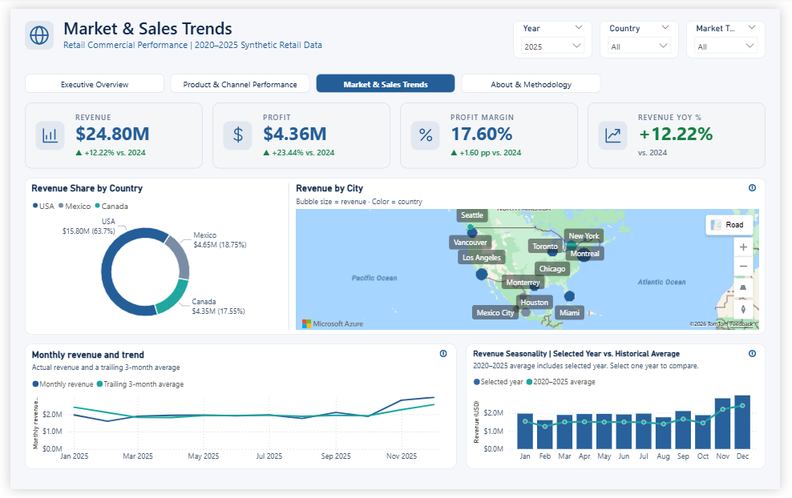
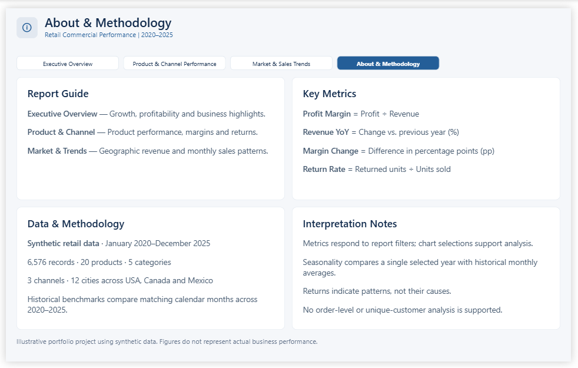

# 🏢Retail Commercial Performance | Power BI Dashboard

An interactive Power BI dashboard exploring **retail revenue, profitability, product performance, returns, and geographic sales trends**.

This portfolio project demonstrates how business intelligence, data modeling, DAX calculations, and interactive reporting can support commercial performance analysis using **synthetic retail data from 2020–2025**.

## 🛠️Tools & Skills

**Power BI Desktop | Power Query | DAX | Data Modeling | KPI Development | Data Visualization | Business Intelligence | Data Storytelling**

Developed using the **Power BI Project (PBIP)** format, with report and semantic-model definitions available for technical review.

## 📊Dashboard Preview

### 1. Executive Overview

### 2. Product & Channel Performance

### 3. Market & Sales Trends

### 4. About & Methodology

## 🎯Business Questions

The dashboard addresses five key questions:

1. How are revenue, profit, and profit margins changing over time?
2. Which products, categories, and sales channels contribute most to commercial performance?
3. Which products generate strong revenue but comparatively lower profit margins?
4. Where are product return rates elevated?
5. How do geographic markets and seasonal sales patterns compare?

## 📈Key Findings | 2025

| Metric | Result |
|---|---|
| **Revenue** | $24.80M (+12.22% YoY) |
| **Profit** | $4.36M (+23.44% YoY) |
| **Profit Margin** | 17.60% (+1.60 pp YoY) |
| **Units Sold** | 121.65K |
| **Return Unit Rate** | 5.42% |

### Business Observations

- **Profitability improved:** Profit growth (+23.44%) exceeded revenue growth (+12.22%), while profit margin increased by 1.60 percentage points.
- **Category profitability varies:** Electronics generated approximately $8.46M in revenue but recorded a 13.46% profit margin, below the overall portfolio margin of 17.60%.
- **Returns warrant attention:** Fashion recorded an 8.42% return-unit rate, compared with the portfolio rate of 5.42%.

These findings highlight areas for further business investigation rather than establishing the causes of performance differences.

> All results are illustrative and do not represent actual business performance.

## 🖥️Dashboard Pages

| Page | Analytical Focus |
|---|---|
| **Executive Overview** | Executive KPIs, revenue trends, category performance, and dynamic business highlights |
| **Product & Channel Performance** | Product rankings, revenue versus profitability, return rates, and channel margins |
| **Market & Sales Trends** | Country and city performance, monthly revenue trends, and seasonality |
| **About & Methodology** | KPI definitions, dataset coverage, calculation methodology, and interpretation notes |

The three analytical pages feature interactive slicers, chart cross-filtering, and information buttons explaining key metrics and comparisons.

## 🗃️Dataset & Data Model

The project uses **6,576 synthetic sales records** covering January 2020–December 2025.

- **Products:** 20 products across five categories
- **Sales channels:** Online, Retail Stores, and Wholesale
- **Geography:** 12 cities across the USA, Canada, and Mexico
- **Currency:** USD

The model follows a star-schema-style structure, with a sales fact table connected to Date, Product, and Location dimensions through active one-to-many relationships.

The dataset contains aggregated sales records rather than individual customer transactions.

## ▶️Open the Interactive Dashboard

**Option 1 — Explore the completed dashboard**

[Download the Interactive Power BI Dashboard (.pbix)](Retail_Commercial_Performance.pbix)

Open the downloaded file in Power BI Desktop. The report includes imported synthetic data, so no initial refresh is required.

**Option 2 — Review the development project**

Open `Retail_Commercial_Performance.pbip` in a compatible Power BI Desktop version to inspect the editable report and semantic-model definitions.

**Data refresh:** The four CSV source files are publicly hosted in the [`sales_data`](sales_data/) folder. Power BI retrieves them using `Web.Contents`. If prompted, select **Anonymous** authentication.

## 📐Methodology & Limitations

- **Profit Margin:** Total Profit ÷ Total Revenue.
- **Return Unit Rate:** Returned Units ÷ Units Sold.
- **Year-over-Year Growth:** Compares performance with the corresponding prior-year period.
- **Margin Change:** Expressed in percentage points (pp).
- **Revenue Trend:** Uses a trailing three-month average to support trend interpretation.
- **Seasonality:** Compares monthly revenue for one selected year against historical averages for the same calendar months across 2020–2025.

**Important limitations:**

- The dataset is synthetic and does not represent a real retailer.
- No unique customer or order identifiers are available for customer-level or transaction-level analysis.
- Geographic coverage is limited to the three countries included in the dataset.
- Observed differences in profitability or returns do not establish causation.

## 🤖AI-Assisted Development

AI tools, including **Claude and ChatGPT/Codex**, supported aspects of dashboard implementation, DAX troubleshooting, technical development, and documentation.

The project author reviewed and validated the business objectives, analytical interpretation, calculations, functionality, and final dashboard design.

---

*Illustrative portfolio project using synthetic data. Figures do not represent actual business performance.*
